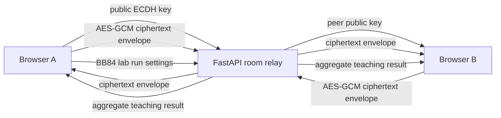

# QKD Chat Lab

A classroom secure-chat application for exploring browser-based encryption and
a BB84 security simulation.

QKD Chat Lab pairs two browser clients in a room. Chat uses P-256 ECDH and
HKDF-SHA-256 to derive directional AES-256-GCM keys. A separate room-hosted
BB84 lab demonstrates basis selection, sifting, QBER and educational
post-processing; its output does not supply chat keys.



> **Security status:** The relay stores and forwards ciphertext for encrypted
> chat messages, but the public-key exchange is not automatically authenticated.
> Until participants compare the complete 12-digit safety code through another
> trusted channel, an active man-in-the-middle attack remains possible. This
> classroom prototype has no authenticated accounts, Double Ratchet, forward
> secrecy or post-compromise security. The BB84 lab is a software simulation,
> not physical quantum key distribution. Use it for demonstrations and
> controlled testing, not confidential or high-risk communication.

## What you can explore

- **Encrypted chat:** two browser endpoints encrypt and decrypt messages locally.
  AES-256-GCM uses separate directional keys; the backend relays ciphertext.
- **Image and video attachments:** choose and preview a file, then send it in a
  ready encrypted room. File bytes are encrypted in the sender's browser and
  decrypted in the recipient's browser; files can be up to 10 MB.
- **Encryption demo:** compare a disposable local learning exercise with live
  chat observations. Learning keys are separate from chat keys.
- **BB84 Security Lab:** inspect a room-hosted educational simulation with Alice,
  Bob, Eve, QBER, reconciliation and privacy amplification. A completed
  experiment does not change chat encryption.

## Run locally

Docker Desktop or another Docker Compose-compatible runtime is required.

```bash
cp .env.example .env
docker compose up --build -d
```

Open [http://localhost:8080](http://localhost:8080) in two browser windows or
profiles. Create a room in one and join it from the other. When both show
**Encrypted · Unverified**, compare the full safety code through a separate
trusted channel and verify it in each browser before sending messages.

To stop the application while keeping its local message history:

```bash
docker compose down
```

The local database is stored in a named Docker volume. Removing that volume with
`docker compose down -v` permanently deletes the local chat history.

## Try a demonstration

1. Join the same room in two browser profiles with different names.
2. Compare and verify the safety code out of band.
3. Send text in both directions; try an image or short video.
4. Open **Encryption demo** to inspect the learning exercise or live observations.
5. Open **BB84 lab** to run and review the separate room-hosted simulation.

The [panel demonstration guide](docs/PANEL_DEMO.md) provides a timed walkthrough.
For hosted demonstrations, see [Render setup and limitations](docs/FREE_HOSTING.md).
For two Macs on the same private network, follow [LAN setup](docs/LAN_SETUP.md).

## Verify changes

The [testing guide](docs/TESTING.md) has frontend, backend, Docker and browser
checks. Historical results are summarized in [test results](docs/TEST_RESULTS.md);
check each report's date and evidence availability before treating it as a
current verification.

## Technology stack

- **Frontend:** React, TypeScript and Vite.
- **Backend:** Python, FastAPI, Uvicorn and SQLite.
- **Serving and local runtime:** Nginx and Docker Compose.
- **Browser cryptography:** Web Crypto API.

## Project map

```text
frontend/       React, TypeScript and Vite browser application
backend/        FastAPI relay, room-hosted BB84 simulator and SQLite storage
deploy/         Render Docker image and startup script
scripts/        LAN launcher and smoke-test helpers
docs/           Architecture, API, security, setup and testing guides
```

For configuration and development without Docker, see [development and configuration](docs/DEVELOPMENT.md).

The repository's documentation index is [docs/README.md](docs/README.md).
