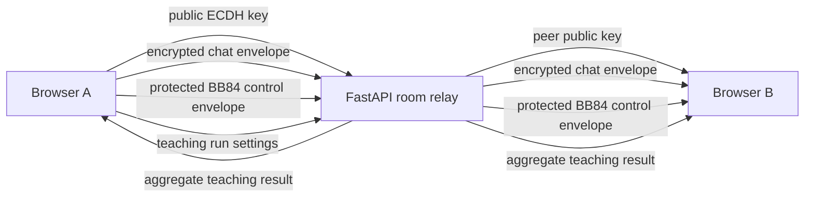

# QKD Chat Lab

A classroom secure-chat application for exploring browser-based encryption and
BB84. Chat supports ECDH-only mode and an optional endpoint-owned BB84 + ECDH
hybrid mode. The separate room-hosted BB84 lab is an educational simulation.



> **Security status:** Chat content is encrypted in the browsers and the relay
> stores ciphertext. The public-key exchange is not automatically authenticated;
> compare the complete 12-digit safety code through another trusted channel to
> reduce active man-in-the-middle risk. The application has no authenticated
> accounts, Double Ratchet, forward secrecy or post-compromise security. BB84 is
> a software simulation, not physical quantum key distribution, and does not
> provide security independent of ECDH. Use this classroom prototype for
> demonstrations and controlled testing, not confidential or high-risk
> communication.

## What you can explore

- **Encrypted chat:** browsers derive directional AES-256-GCM keys locally.
  ECDH-only mode remains available as a fallback.
- **Endpoint-owned BB84 key exchange:** both browsers independently run the
  simulation. Reconciliation, privacy amplification and mutual key confirmation
  must succeed before the matching contribution is combined with the ECDH
  secret through HKDF-SHA-256 to derive a hybrid chat-key epoch. The backend
  relays protected control messages; it does not receive BB84 contributions or
  final chat keys.
- **BB84 Security Lab experiment:** the room-hosted teaching simulation reports
  QBER and post-processing results. It is separate from endpoint key exchange
  and does not itself change chat keys. Its estimates are educational, not a
  finite-key security proof.
- **Image and video attachments:** choose and preview a file in a ready
  encrypted room. File bytes are encrypted in the sender's browser and
  decrypted in the recipient's browser; files can be up to 10 MB.
- **Encryption demo:** compare a disposable local learning exercise with live
  chat observations. Learning keys are separate from chat keys.

## Run locally

Docker Desktop or another Docker Compose-compatible runtime is required.

```bash
cp .env.example .env
docker compose up --build -d
```

Open [http://localhost:8080](http://localhost:8080) in two browser windows or
profiles. Create a room in one and join it from the other. When both show
**Encrypted · Unverified**, compare the full safety code through a separate
trusted channel and verify it in each browser before sending messages.

To stop the application while keeping its local message history:

```bash
docker compose down
```

Removing the named data volume with `docker compose down -v` permanently deletes
the local chat history.

## Try a demonstration

1. Join the same room in two browser profiles with different names.
2. Compare and verify the safety code out of band.
3. Exchange text in both directions; try an image or short video.
4. Start BB84 key exchange in both browsers and review progress, QBER and the
   final key-confirmation status. A hybrid epoch is active only after both
   endpoints confirm matching keys.
5. Run the room-hosted BB84 experiment separately to inspect its teaching
   results, with and without simulated Eve.

The [panel demonstration guide](docs/PANEL_DEMO.md) provides a walkthrough. For
hosted demonstrations, see [Render setup and limitations](docs/FREE_HOSTING.md).
For two Macs on a private network, follow [LAN setup](docs/LAN_SETUP.md).

## Verify changes

The [testing guide](docs/TESTING.md) has frontend, backend, Docker and browser
checks. Historical results are summarized in [test results](docs/TEST_RESULTS.md);
check each report's date and evidence availability before treating it as a
current verification.

## Technology stack

- **Frontend:** React, TypeScript and Vite.
- **Backend:** Python, FastAPI, Uvicorn and SQLite.
- **Serving and local runtime:** Nginx and Docker Compose.
- **Browser cryptography:** Web Crypto API.

## Project map

```text
frontend/       React, TypeScript and Vite browser application
backend/        FastAPI relay, endpoint BB84 protocol and teaching simulator
deploy/         Render Docker image and startup script
scripts/        LAN launcher and smoke-test helpers
docs/           Architecture, API, security, setup and testing guides
```

For configuration and local development, see [development and configuration](docs/DEVELOPMENT.md).
The documentation index is [docs/README.md](docs/README.md).
